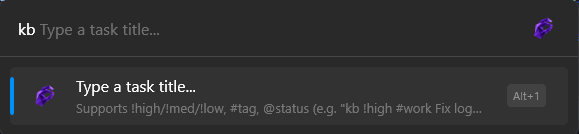
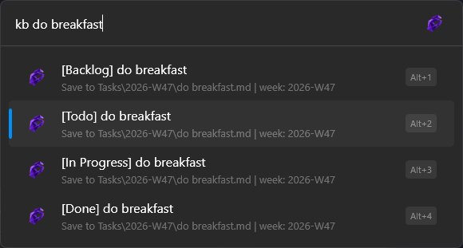
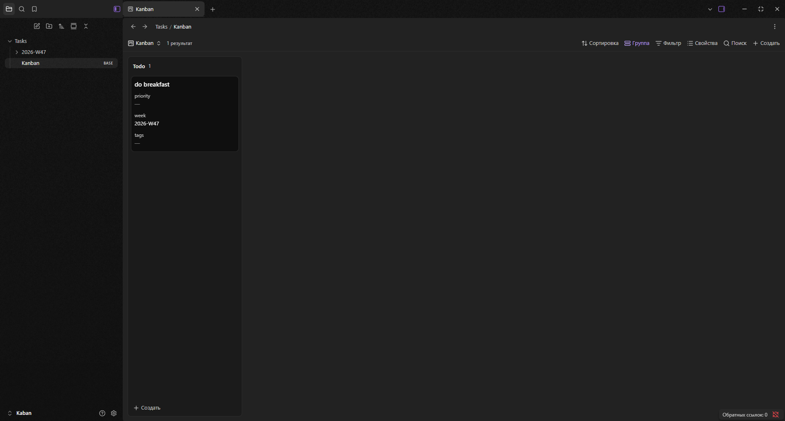
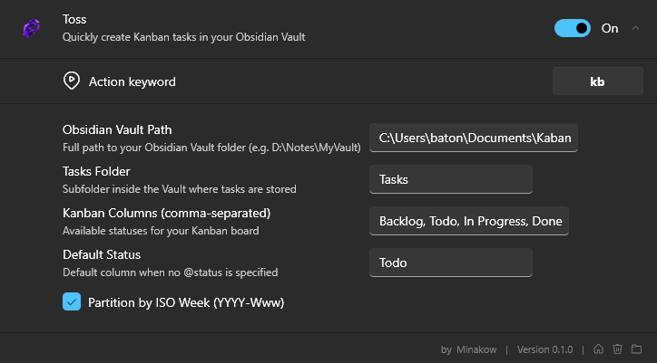

<p align="center">
  
</p>

# Toss - Obsidian Kanban for Flow Launcher

A zero-dependency Node.js plugin for [Flow Launcher](https://www.flowlauncher.com/) that lets you quickly capture and organize Kanban tasks in your [Obsidian](https://obsidian.md/) Vault using [Obsidian Bases Kanban view](https://obsidian.md/help/bases/views/kanban).

## Features

- **Instant capture** via the `kb` keyword in Flow Launcher
- **Inline metadata**:
  - Priority: `!high` / `!1`, `!med` / `!2`, `!low` / `!3`
  - Tags: `#work`, `#dev`, etc.
  - Target column: `@todo`, `@in`, `@done`, etc.
- **Weekly partitioning**: tasks are stored in `Tasks/YYYY-Www/Task Name.md` so your Vault stays clean
- **Auto-generated `Kanban.base`**: automatically creates `Kanban.base` in your tasks folder on first run

## Screenshots

| Typing `kb` | Choosing column |
| --- | --- |
|  |  |

| Obsidian Bases Kanban View | Plugin Settings |
| --- | --- |
|  |  |

## Installation

1. Copy (or symlink) this folder to `%APPDATA%\FlowLauncher\Plugins\Toss-0.1.0`.
2. Restart Flow Launcher.
3. Open **Flow Launcher Settings → Plugins → Obsidian Kanban** and set your **Obsidian Vault Path**.

## Usage

```text
kb !high #work @todo Fix auth bug
```

## Development

```powershell
npm test
```
